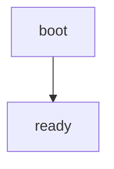

This page ships the MathJax runtime without declaring it: colophon found the
math itself. The cost is $2^N$ per node and $$T = N \log N$$ overall.

Continue on [the first page](first.md#target-section).
